<div align="center">


# Bagley

[](https://github.com/H4ch1Net/bagley-assistant/actions/workflows/ci.yml)

[](LICENSE)

</div>

Bagley is a personal assistant that runs a language model on your own computer. It can search the web, work with files in a folder you choose, check the weather, do exact arithmetic and set reminders. It asks before it changes anything, and chats, memories and settings stay in a SQLite file on your machine.

Built with FastAPI, uvicorn, websockets, httpx, the Anthropic SDK and psutil, plus a plain JavaScript web UI with no build step.

<div align="center">
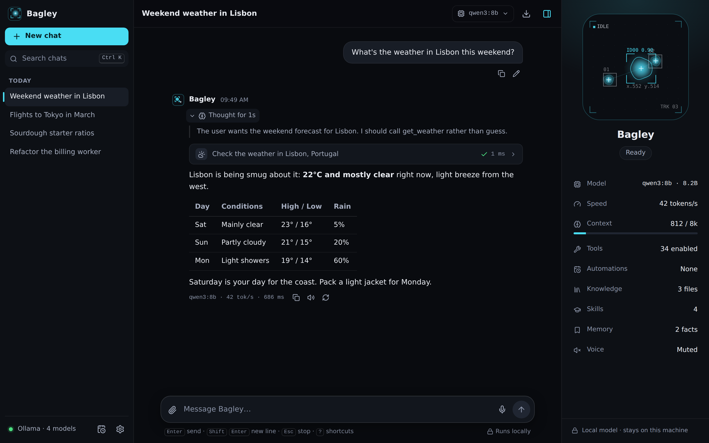
</div>

## What it does

- Calls tools in a loop until it has an answer: web search, page reading, weather, a calculator, time zones, workspace files, long-term memory, reminders and an optional shell.
- Waits for your approval before file changes, shell or Python commands, new scheduled tasks and page watchers. Each tool can be switched off in Settings > Tools.
- Runs reminders, scheduled tasks and page watchers in the background. Each one posts into its own chat and sends a notification.
- Searches the folders you add (text, Markdown, code, HTML and PDF) by keyword, and by meaning when an embedding model is installed. Answers name the files they came from.
- Journals every file change, so a bad edit can be reverted from its tool card.
- Runs Python scripts in the workspace and shows any charts they produce inline, after you approve the run.
- Works with local models through Ollama, LM Studio, llama.cpp, vLLM and other OpenAI-compatible servers, and with hosted APIs such as Claude, OpenAI, OpenRouter, Groq, Mistral, Gemini, DeepSeek and xAI.
- Routes requests across your machines, for example a GPU desktop over Tailscale, this laptop and a cloud API. `bagley bench` tests the installed models on tool-use tasks and picks the best one per machine.
- Keeps chat history you can search, rename, delete with undo, export as Markdown, edit and resend. Drop text files on the composer to save them in the workspace.
- Has keyboard shortcuts: Ctrl+K searches chats, / focuses the message box, Esc stops a reply, Ctrl+. toggles the side panel, and ? lists them all.
- Has optional voice (a wake word, dictation and spoken replies), phone access over Tailscale with an installable app, study, cybersecurity and work modes, routines you can record and replay, and an always-on runner for automations. Each is covered in the guides below.
- Extends with Python plugins and MCP servers.
- On Linux, can also live on the desktop: a Hyprland overlay, a shell command helper for zsh, `bagley why` for failed commands, and a morning briefing about services, disks, updates and security. Set these up with `bagley desktop install`.

## Screenshots

<table>
  <tr>
    <td width="50%">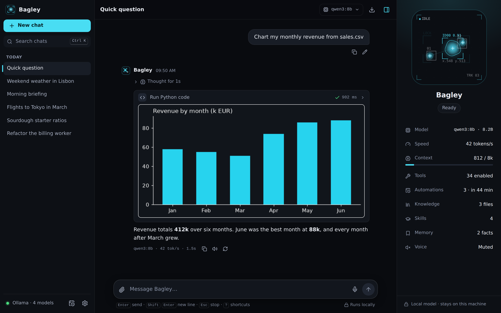<br><sub>Python runs in the workspace and its charts appear in the chat.</sub></td>
    <td width="50%">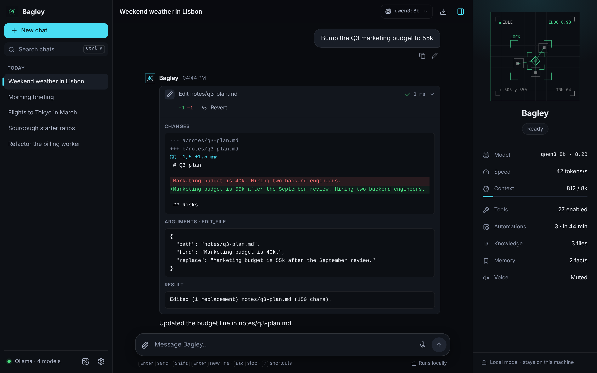<br><sub>File changes show a diff and can be reverted.</sub></td>
  </tr>
  <tr>
    <td>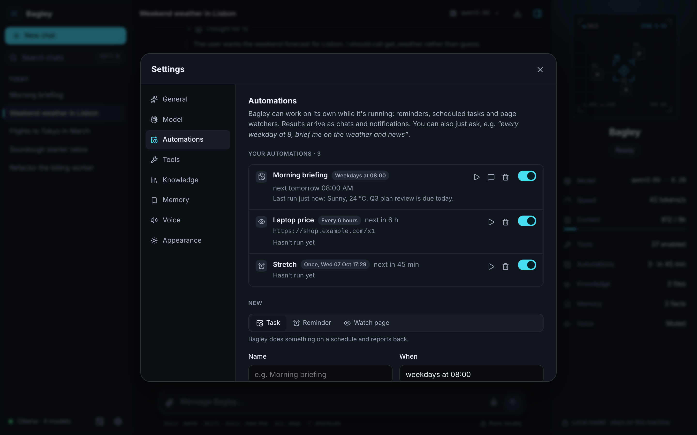<br><sub>Scheduled tasks, reminders and page watchers.</sub></td>
    <td>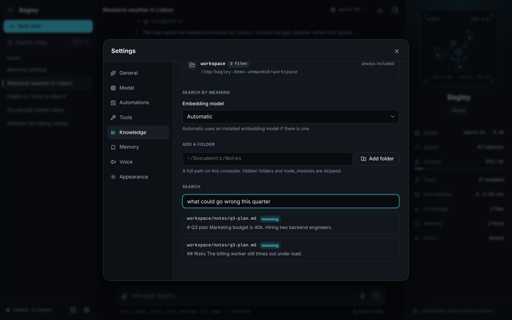<br><sub>Knowledge base with keyword and semantic search.</sub></td>
  </tr>
  <tr>
    <td width="50%">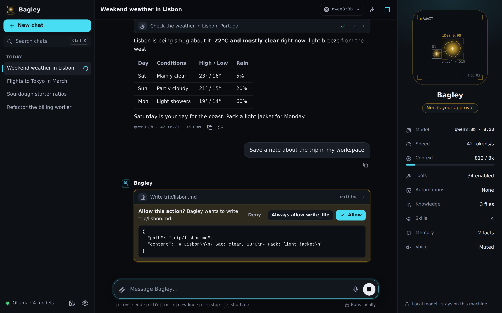<br><sub>Actions that change things wait for approval.</sub></td>
    <td width="50%">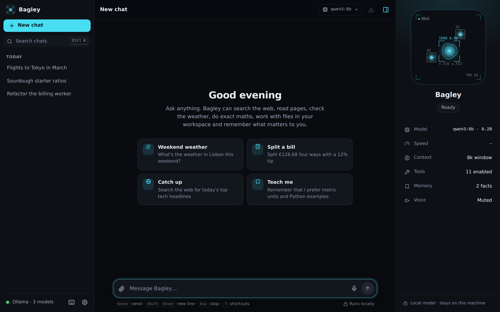<br><sub>Start screen.</sub></td>
  </tr>
  <tr>
    <td>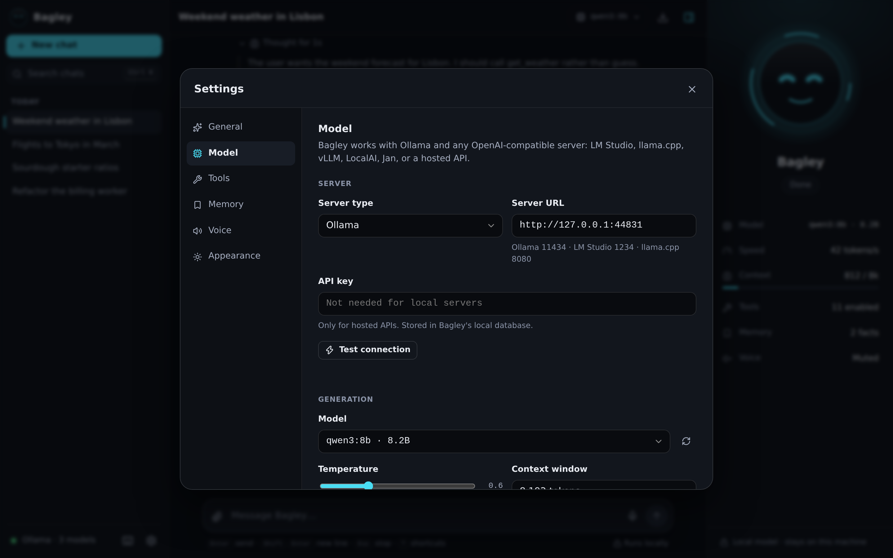<br><sub>Model settings, installed models and what is loaded in memory.</sub></td>
    <td>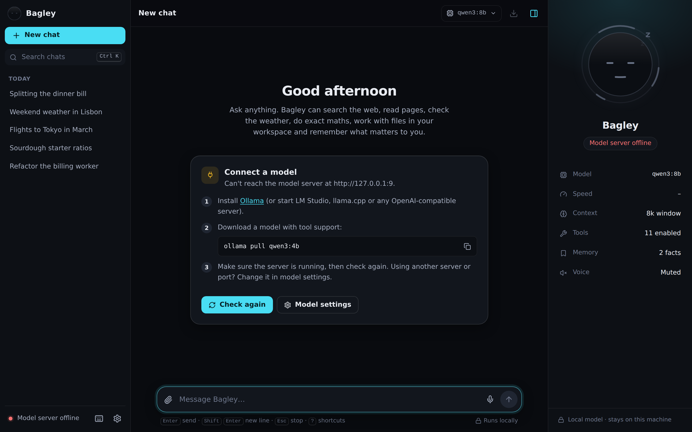<br><sub>First run without a model server. The tracker reads NO SIGNAL.</sub></td>
  </tr>
  <tr>
    <td>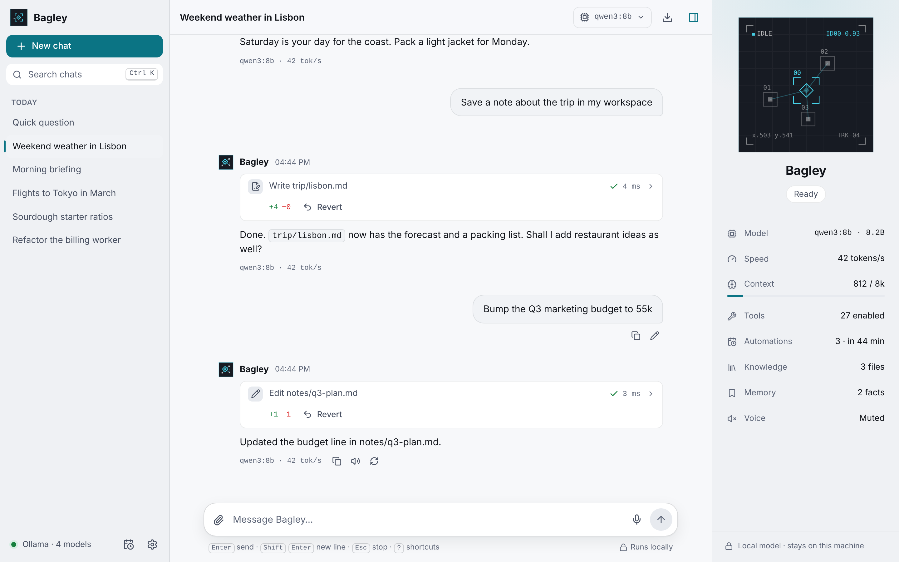<br><sub>Light theme.</sub></td>
    <td align="center">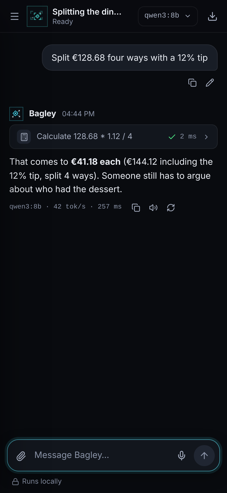<br><sub>Phone layout.</sub></td>
  </tr>
</table>

## How it works

The web UI talks to a FastAPI server over a WebSocket. Each message you send starts an agent run. The agent builds the context from the persona, the date, your memories, the list of available tools and the recent history, trimmed to fit the context window. It streams the model's reply, runs any tool calls, and repeats until the model answers without calling a tool or reaches the step limit (`BAGLEY_MAX_STEPS`, 8 by default). Every step is saved to the database and streamed to the browser as it happens.

Ollama is reached through its native chat API, and other servers through the OpenAI-compatible API. Claude goes through the official Anthropic SDK. With `BAGLEY_PROVIDER=auto` (the default), Bagley recognises the Anthropic API by its address and any server whose URL ends in `/v1` as OpenAI-compatible, and probes everything else for Ollama. Models without native function calling get tools through a text-based protocol automatically.

Routing is automatic by default. Each request goes to the first GPU machine that answers, then this machine, then other local machines, then cloud APIs. A machine that fails is skipped for 45 seconds. Small jobs such as chat titles and shell one-liners can stay on this machine. Each reply names the machine that produced it.

Scheduled work runs inside the Bagley process, so automations only run while Bagley is running. Schedules can be written in plain language, such as "in 45 minutes", "daily at 07:30", "weekdays at 09:00" or "every 2 hours".

Search has two parts. A keyword index (SQLite FTS5) is always on. When an embedding model is installed, Bagley also indexes the documents by meaning, in chunks of about 900 characters, and merges the two rankings. The index refreshes every 15 minutes and on demand.

Everything is stored under `~/.bagley` unless `BAGLEY_DATA_DIR` says otherwise. `bagley.db` holds chats, memories, settings, automations and the file change journal. `knowledge.db` holds the search index. `journal/` keeps earlier versions of changed files, and `workspace/`, `plugins/` and `mcp.json` sit beside them.

A hosted API is used only after you add a key for it. By default it is the fallback when none of your machines answers. Local servers keep requests on your machine.

Bagley listens on `127.0.0.1` only. If you bind it to another address, it requires an access token, which the startup output prints in the URL. The server rejects foreign Host headers and cross-origin requests, so other websites cannot drive it. File tools stay inside the workspace folder, symlinks included, and web tools refuse localhost and private addresses unless `BAGLEY_ALLOW_PRIVATE_URLS` is set. Shell and Python tools are off until you enable them. Automations run without you watching, so tools that need approval are denied during those runs.

## Install

Bagley needs Python 3.10 or newer, and a model server or a hosted API key. The easiest local server is [Ollama](https://ollama.com/download):

```bash
curl -fsSL https://ollama.com/install.sh | sh
ollama pull qwen3:4b
```

Install Bagley with pipx, uv, or pip from a clone:

```bash
sudo apt install pipx && pipx ensurepath
pipx install git+https://github.com/H4ch1Net/bagley-assistant
# or: uv tool install git+https://github.com/H4ch1Net/bagley-assistant
# or, from a clone: pip install -e .
```

Models with tool support work best. See [Choosing a model](#choosing-a-model).

## Run

```bash
bagley
```

This opens <http://127.0.0.1:8765>. If no model server is found, the start screen walks you through connecting one. With Ollama you can also download models from the UI. `bagley doctor` checks the model server, installed models, tool support, workspace, plugins and MCP servers.

To run it in a terminal instead, use `bagley chat`. For scripts and pipes, `bagley ask` prints one answer to stdout.

## Tests

```bash
git clone https://github.com/H4ch1Net/bagley-assistant
cd bagley-assistant
python -m venv .venv && source .venv/bin/activate   # Windows: .venv\Scripts\activate
pip install -e ".[dev]"

pytest                                # unit, API and WebSocket tests
ruff check . && ruff format --check .
```

The tests run against `tests/mock_llm.py`, a scripted server that speaks both the Ollama and OpenAI wire formats, so they need no model and no network.

Browser tests use Playwright:

```bash
pip install -e ".[dev,screenshots]"
python -m playwright install chromium
pytest -m ui
```

## Demo

`python scripts/screenshots.py --serve` starts Bagley at http://127.0.0.1:8790 in a throwaway data folder. It uses the scripted model server from `tests/mock_llm.py` and fake weather and search services, so it does not touch `~/.bagley`. Run the same script without `--serve` to regenerate the images in `docs/screenshots/`.

The `examples/` folder has two sample files. `examples/plugins/example_tools.py` adds a `roll_dice` tool. Copy it into your plugins folder and run `bagley doctor` to see it listed:

```bash
mkdir -p ~/.bagley/plugins
cp examples/plugins/example_tools.py ~/.bagley/plugins/
bagley doctor
```

`examples/mcp.json` shows the MCP server format. Copy it to `~/.bagley/mcp.json`, change the paths, and restart Bagley.

## Configuration

Settings changed in the UI are stored in the database. Environment variables, or a `.env` file in the folder you start Bagley from, take precedence, and the fields they set are locked in the UI. `.env.example` lists every option. A minimal local setup looks like this:

```bash
BAGLEY_PROVIDER=ollama
BAGLEY_BASE_URL=http://localhost:11434
BAGLEY_MODEL=qwen3:4b
BAGLEY_CONTEXT_TOKENS=8192
BAGLEY_ENABLE_SHELL=false
```

To add Claude as a machine:

```bash
export ANTHROPIC_API_KEY=sk-ant-...
bagley machines add Claude --preset claude   # Claude Opus 5.5; --model claude-sonnet-5-5 for another
bagley machines route                        # which machine and model answer now
```

Hosted API keys can also be saved under Settings > Model & machines > Hosted APIs. Press Test key there to list the models before anything is saved.

| Variable | Default | Description |
|---|---|---|
| `BAGLEY_PROVIDER` | `auto` | `auto`, `ollama`, `openai` or `anthropic` |
| `BAGLEY_BASE_URL` | `http://localhost:11434` | Model server URL. `OLLAMA_HOST` is used if this is unset. |
| `BAGLEY_API_KEY` | | Key for a hosted API. Empty: the provider's own variable below. |
| `ANTHROPIC_API_KEY`, `OPENAI_API_KEY`, `OPENROUTER_API_KEY`, `GROQ_API_KEY`, `MISTRAL_API_KEY`, `GEMINI_API_KEY`, `DEEPSEEK_API_KEY`, `XAI_API_KEY` | | Keys for hosted APIs whose key is not saved in Settings |
| `BAGLEY_MODEL` | first tool-capable model | Model name |
| `BAGLEY_TEMPERATURE` | `0.6` | 0 to 2 |
| `BAGLEY_CONTEXT_TOKENS` | `8192` | Context window. Sent to Ollama as `num_ctx`. History is trimmed to fit. |
| `BAGLEY_MAX_STEPS` | `8` | Tool rounds per reply |
| `BAGLEY_TOOL_MODE` | `auto` | `auto`, `native`, `prompt` (text-based) or `off` |
| `BAGLEY_THINK` | `false` | Let reasoning models think before answering |
| `BAGLEY_PERSONA` | `bagley` | `bagley`, `professional` or `concise` |
| `BAGLEY_HOST` | `127.0.0.1` | Bind address |
| `BAGLEY_PORT` | `8765` | Port |
| `BAGLEY_TOKEN` | | Access token. Generated automatically when listening beyond localhost. |
| `BAGLEY_ALLOWED_HOSTS` | | Extra Host header names, comma separated |
| `BAGLEY_DATA_DIR` | `~/.bagley` | Database, workspace, plugins |
| `BAGLEY_WORKSPACE` | `<data dir>/workspace` | Folder the file tools can use |
| `BAGLEY_PLUGINS_DIR` | `<data dir>/plugins` | Python files with extra tools |
| `BAGLEY_MCP_CONFIG` | `<data dir>/mcp.json` | MCP server list |
| `BAGLEY_ENABLE_SHELL` | `false` | Register the `run_command` and `run_python` tools |
| `BAGLEY_PYTHON` | Bagley's own | Python interpreter for `run_python`, for example a venv with pandas and matplotlib |
| `BAGLEY_ALLOW_PRIVATE_URLS` | `false` | Let web tools reach private addresses |
| `BAGLEY_SEARXNG_URL` | | Use SearXNG for web search |
| `BAGLEY_PUBLIC_URL` | | Address that notification clicks open, for example your Tailscale name for the phone |
| `BAGLEY_TAILSCALE_USERS` | | Tailscale logins allowed to use Bagley over the tailnet, comma separated |
| `BAGLEY_GIT_EMAILS` | from git config | Author emails counted in "Your life". `*` counts everyone. |
| `BAGLEY_WATCHDOG` | on Linux | `1` or `0` to force the watchdog tools on or off |
| `BAGLEY_URL`, `BAGLEY_TOKEN` | `http://127.0.0.1:8765` | For the clients (`bagley see`, the overlay, the zsh plugin, `bagley status`): the server to talk to |

## Command line

| Command | Description |
|---|---|
| `bagley` | Start the server and open the browser. Same as `bagley serve`. |
| `bagley serve --port 9000 --no-browser` | Start on another port without opening a tab. `--host` sets the bind address. |
| `bagley chat` | Chat in the terminal. `-c <id>` continues a conversation. Approvals are asked inline. |
| `bagley ask "question"` | Print one answer. Piped input is attached, so `git diff \| bagley ask "write a commit message"` works. Tools that need approval only run with `--yes`. `-q` hides tool activity. |
| `bagley doctor` | Check the model server, installed models, tools, workspace, plugins and MCP servers. |
| `bagley machines add`, `route`, `remove` | Manage the machines Bagley routes to |
| `bagley bench` | Test installed models on tool-use tasks |
| `bagley desktop install` | Install the overlay, Hyprland binds, mako style, zsh plugin and systemd units |
| `python -m bagley` | Same as `bagley` |

Run `bagley --help` for the full list, which also covers the watchdog, voice, Tailscale, service, routine and work commands.

## Tools

| Tool | What it does | Asks first |
|---|---|:---:|
| `web_search` | Search DuckDuckGo, or your SearXNG instance | |
| `fetch_webpage` | Download a page and extract its readable text | |
| `get_weather` | Current weather and forecast from Open-Meteo | |
| `calculate` | Exact arithmetic and math functions, evaluated safely | |
| `get_current_time` | Date and time in any time zone | |
| `list_files`, `read_file`, `search_files` | Browse and read the workspace folder | |
| `write_file`, `edit_file`, `move_file`, `delete_file` | Change files in the workspace. Journaled and revertible. | yes |
| `make_directory` | Create a folder in the workspace | |
| `search_knowledge`, `read_document` | Search and read your indexed documents | |
| `remember`, `forget` | Long-term memory, included in every conversation | |
| `set_reminder`, `list_automations`, `cancel_automation` | Reminders and managing automations | |
| `schedule_task`, `watch_webpage` | Create a recurring task or a page watcher | yes |
| `system_status` | CPU, memory, disk, battery, uptime and the busiest processes | |
| `open_on_computer` | Open a web page or a workspace file on your screen | yes |
| `notify_user` | Show a notification | |
| `run_command`, `run_python` | Run a shell command or a Python script in the workspace. Off unless `BAGLEY_ENABLE_SHELL=true`. | yes |

Tools can be switched off one by one in Settings > Tools. File tools cannot leave the workspace folder.

## Choosing a model

Bagley uses the first installed model that supports tools unless you choose one. Good starting points with Ollama:

| Model | Size | Notes |
|---|---|---|
| `qwen3:4b` | 2.5 GB | Fast, reliable tool use. Recommended default. |
| `llama3.2:3b` | 2.0 GB | Small and quick |
| `qwen3:8b` | 5.2 GB | Better reasoning |
| `gpt-oss:20b` | 14 GB | Best quality of these. Needs about 16 GB of memory. |

Models without native function calling, such as `gemma2`, still get tools through the text-based protocol. You can force a mode under Settings > Model > Tool calling.

Other servers take a `BAGLEY_BASE_URL` like these:

| Server | `BAGLEY_BASE_URL` |
|---|---|
| Ollama | `http://localhost:11434` |
| LM Studio | `http://localhost:1234/v1` |
| llama.cpp (`llama-server --jinja`) | `http://localhost:8080/v1` |
| vLLM | `http://localhost:8000/v1` |
| OpenRouter, OpenAI and other hosted APIs | the provider's base URL, plus `BAGLEY_API_KEY` |

## Guides

- [Desktop](docs/desktop.md): the Quickshell overlay, bar segment, Hyprland binds and mako. Also `bagley see` and `bagley explain`.
- [Shell](docs/shell.md): `??` in zsh and `bagley why`
- [Watchdog](docs/watchdog.md): the morning briefing and security checks
- [Desktop control](docs/desktop-control.md): windows, workspaces, media, volume, Wi-Fi, power and scenes
- [Voice](docs/voice.md): wake word, whisper.cpp, Piper and ElevenLabs
- [Phone](docs/phone.md): Tailscale, the installable app and ntfy
- [Runner](docs/runner.md): an always-on machine for automations
- [Your life](docs/life.md): Obsidian vaults, repositories and recaps
- [Study](docs/study.md), [Cybersec](docs/cybersec.md) and [Work](docs/work.md): the modes
- [Routines](docs/routines.md): recording and replaying approved actions
- [Sandbox](docs/sandbox.md): permission tiers, bubblewrap and the audit log
- [Bench](docs/bench.md): testing models on real tool-use tasks

## Extending

### Plugins

Any Python file in `~/.bagley/plugins/` is loaded at startup. Decorate a function with `@tool`. Type hints become the parameter schema, and the docstring becomes the description the model sees. Add `risk="confirm"` to ask before every call. See `examples/plugins/example_tools.py`. Load errors are listed under Settings > Tools and in `bagley doctor`.

### MCP servers

Bagley is an MCP client for stdio servers. Describe the servers in `~/.bagley/mcp.json`, in the same format other MCP clients use, and restart:

```json
{
  "mcpServers": {
    "filesystem": {
      "command": "npx",
      "args": ["-y", "@modelcontextprotocol/server-filesystem", "/home/me/notes"]
    }
  }
}
```

Each server's tools appear as `<server>__<tool>`. Each call asks for approval unless the server sets `"trust": true`.

## Troubleshooting

- Can't reach the model server. Start Ollama with `ollama serve`, and check the URL under Settings > Model. If Ollama runs on another machine or in Docker, set `BAGLEY_BASE_URL` to its address and start Ollama with `OLLAMA_HOST=0.0.0.0`. `bagley doctor` shows what fails.
- The model never uses tools, or prints raw JSON. Use a model with tool support, or set Tool calling to Text-based. Models under 3B parameters are often unreliable with tools.
- Replies are slow, or the model forgets earlier messages. Lower or raise the context window under Settings > Model. Turn off Reasoning for faster answers from thinking models.
- Knowledge search only matches exact words. Run `ollama pull nomic-embed-text` (or choose an embedding model under Settings > Knowledge), then press Reindex.
- `run_python` can't import pandas or matplotlib. Point `BAGLEY_PYTHON` at a Python that has them, such as a virtual environment's `bin/python`.
- Web search returns nothing. DuckDuckGo sometimes rate limits automated searches. Run your own [SearXNG](https://docs.searxng.org/) with the JSON format enabled and set `BAGLEY_SEARXNG_URL`.
- Using Bagley from a phone or another computer. Start it with `bagley --host 0.0.0.0` and open the printed URL, which includes the access token. Set `BAGLEY_TOKEN` to keep the same token across restarts.
- Port 8765 is already in use. Bagley is probably already running. Otherwise start it on another port with `bagley --port 8766`.

## Contributors

Pull requests are welcome. The code rules and architecture notes are in [CLAUDE.md](CLAUDE.md). Run `pytest` and the linter before you open one.

## License

[MIT](LICENSE). Bundles [marked](https://github.com/markedjs/marked) (MIT), [DOMPurify](https://github.com/cure53/DOMPurify) (Apache-2.0 or MPL-2.0) and icons from [Lucide](https://lucide.dev) (ISC).
